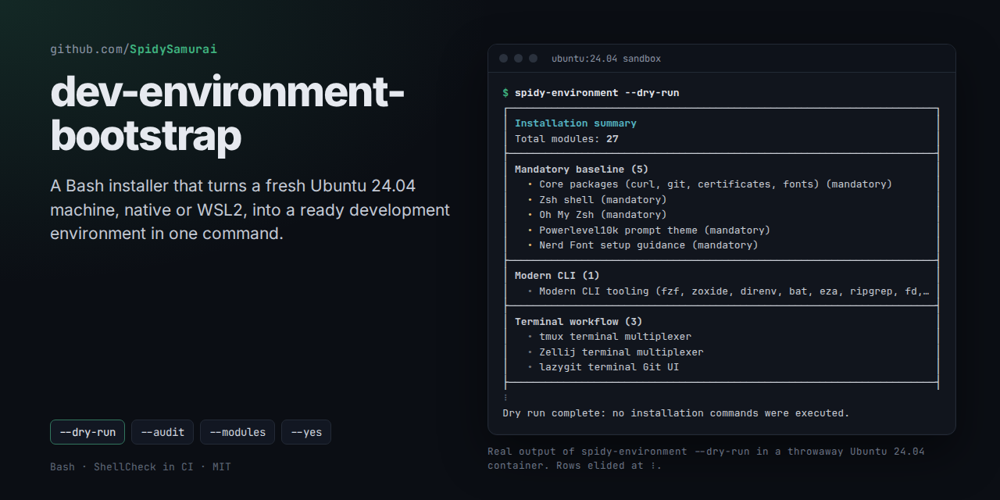

# Dev Environment Bootstrap

A Bash installer that turns a fresh Ubuntu 24.04 machine, native or WSL2, into a ready development environment in one command.

[](https://github.com/SpidySamurai/dev-environment-bootstrap/actions/workflows/ci.yml)
[](LICENSE)



It installs my daily toolchain: Zsh with Oh My Zsh and Powerlevel10k, modern CLI tools, terminal multiplexers, Docker, language runtimes and the coding-agent CLIs, plus my shell and terminal dotfiles. It is opinionated and built for my own machines, and published so anyone rebuilding a Linux or WSL2 setup can read the approach, run it, or fork the catalog. Everything it can do is plain Bash in this repository, and it shows the full plan before it changes anything.

Supported: Ubuntu 24.04 on native Linux or WSL2. Any other system stops with a clear error before installing anything.

## Quick start

```bash
curl -fsSL https://raw.githubusercontent.com/SpidySamurai/dev-environment-bootstrap/main/bootstrap.sh | bash
spidy-environment
```

The first line checks the host, clones this repository into `${XDG_DATA_HOME:-$HOME/.local/share}/spidy-environment` (or fast-forwards it) and puts a `spidy-environment` launcher on your `PATH`. It never reads from stdin, so it is safe to pipe.

`spidy-environment` prints the plan, asks one question (`Install the complete Spidy environment? [Y/n]`) and installs everything. A failing module never stops the rest: the run ends with a report of what was installed, skipped or failed, and why.

Inspect before you install, or install only part of it:

```bash
spidy-environment --audit        # read-only inventory: no network, no changes
spidy-environment --dry-run      # print every command the install would run
spidy-environment --yes          # skip the confirmation once you trust the plan
spidy-environment --non-interactive --modules cli-modern,docker,node-nvm,agent-codex
```

`spidy-environment` runs the checkout's `install.sh` and accepts the same flags (`--help` lists them). From a clone of this repository, run `./install.sh` directly.

## What it installs

Always installed (the baseline):

- apt metadata and core packages: `curl`, Git, CA certificates, fonts and helpers
- Zsh, Oh My Zsh and Powerlevel10k
- a guarded minimal Zsh configuration, used when the dotfiles module is left out

Optional modules, all selected by default. `--modules` narrows the selection:

| Module ID | Contents |
| --- | --- |
| `cli-modern` | fzf, zoxide, direnv, bat, eza, ripgrep, fd, delta |
| `tmux`, `zellij` | tmux (apt) and Zellij (pinned upstream release) |
| `docker` | Docker Engine and Compose packages from Ubuntu |
| `node-nvm`, `bun`, `pnpm`, `go`, `rust` | Node LTS via nvm, Bun, pnpm, Go, Rust |
| `lazygit` | Terminal Git UI (via `go install`) |
| `github-cli` | GitHub CLI |
| `angular-cli` | Angular CLI (`ng`) |
| `zsh-autosuggestions`, `zsh-syntax-highlighting` | Oh My Zsh plugins |
| `agent-gentle-ai`, `agent-pi`, `agent-codex`, `agent-claude-code`, `agent-opencode`, `agent-herdr` | Coding-agent CLIs |
| `spidy-config` | The dotfiles in `config/` (see [Configuration](#configuration)) |

Dependencies resolve automatically: `docker` pulls in its apt prerequisites, `lazygit` pulls in `go`, and npm-based agents pull in `node-nvm`. To use different tools, edit the catalog in `lib/modules.sh`.

## How it works

1. `bootstrap.sh` validates the host, installs `git` if it is missing (its only privileged step), clones or updates the checkout and installs the launcher.
2. `install.sh` resolves the selected modules and their dependencies into a plan and prints it. Nothing changes before you confirm.
3. `sudo` is requested once, up front. Every privileged apt command goes through `lib/common.sh` and appears in the dry-run plan.
4. Each module runs in isolation, so one failure is reported and the run continues.

Runs are idempotent: a module is skipped when its package, path or commands are already present, including tools installed some other way. `spidy-config` is the exception and always re-applies, so a `git pull` followed by a run picks up dotfile changes.

Remote installer scripts (nvm, Bun, rustup, the agent CLIs) are fetched with `curl --fail --proto '=https' --tlsv1.2 --retry 3`, only after confirmation and never in `--dry-run`. Their URLs are listed in `lib/modules.sh`. Zellij, Go and nvm are pinned to a release; Oh My Zsh and gentle-ai follow upstream because they publish no stable ref to pin to (the reason is noted next to each URL).

`--audit` reports each module as `installed (managed source)`, `installed (alternate source)`, `partial` (with the missing commands), `missing`, or `manual/host configuration required`. It checks that commands exist on `PATH`, not their versions, authentication or daemon health.

### Project layout

```text
bootstrap.sh        one-liner entry point: host check, checkout, launcher
install.sh          orchestration: flags, plan, confirmation, run, report
lib/modules.sh      declarative module catalog and dependency graph
lib/installer.sh    plan execution, per-module isolation, audit
lib/config.sh       installs config/ with backups
lib/privileges.sh   one-time sudo negotiation
lib/platform.sh     Ubuntu 24.04 and WSL validation
lib/ui.sh           plan panel and the yes/no confirmation
lib/common.sh       shared command, network and privilege helpers
lib/args.sh         command-line parsing
config/             zsh, Powerlevel10k, Zellij and herdr dotfiles
tests/              test suite and throwaway Docker/WSL sandboxes
```

## Configuration

The `spidy-config` module installs the versioned dotfiles:

| Source | Destination |
| --- | --- |
| `config/zsh/zshrc` | `~/.zshrc` |
| `config/zsh/p10k.zsh` | `~/.p10k.zsh` |
| `config/zellij/config.kdl` | `~/.config/zellij/config.kdl` |
| `config/herdr/config.toml` | `~/.config/herdr/config.toml` |

An existing file is backed up to `<file>.bak.<UTC timestamp>` before it is replaced. The shipped `.zshrc` sources `~/.zshrc.local` when it exists; keep secrets and machine-specific settings there, outside version control.

Leave `spidy-config` out of `--modules` to keep your own dotfiles. The installer then never overwrites or follows an existing `~/.zshrc` or `~/.p10k.zsh`: it creates a minimal one only when none exists, and otherwise prints the single theme line to add.

**Coding agents.** This repository installs the agent CLIs but ships no agent configuration: no skills, prompts, memory setup or settings. Configuration comes from [gentle-ai](https://github.com/Gentleman-Programming/gentle-ai). After the install, run `gentle-ai install` (or `gentle-ai` for the interactive setup). Nothing here writes to `~/.claude`, `~/.codex`, `~/.config/opencode` or `~/.pi`.

**Left to you.** The installer never handles secrets. Afterwards, sign in yourself (`gh auth login` and each agent's login), create your SSH keys, install a Nerd Font such as MesloLGS NF in Windows Terminal, and set up Docker host access (WSL integration, systemd, the `docker` group) if you need it.

## Development

```bash
./tests/run.sh                                     # test suite: no sudo, apt or network
shellcheck install.sh bootstrap.sh lib/*.sh tests/*.sh
./tests/try-in-docker.sh                           # throwaway Ubuntu 24.04 container
./tests/try-in-wsl.sh                              # throwaway WSL2 distribution
```

CI runs ShellCheck (pinned to v0.11.0) and the test suite on every push and pull request to `main`. The sandbox scripts install from a snapshot of your working tree, uncommitted changes included, and leave your own environment untouched.

## License

[MIT](LICENSE)

Built by [Javier Chi Ortiz](https://javierchiortiz.dev).
